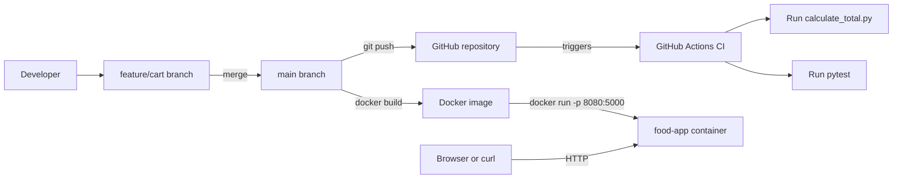
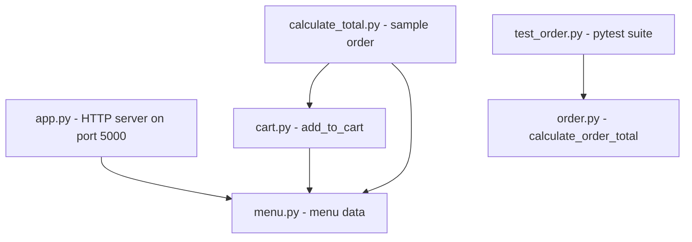

# Online Food Ordering Application


A lightweight Python application for an online food ordering system, built to demonstrate a complete DevOps lifecycle: version control with Git, CI/CD with GitHub Actions, containerization with Docker and automated testing with Pytest.

## Table of Contents
- [Features](#features)
- [Architecture](#architecture)
- [Project Structure](#project-structure)
- [API Endpoints](#api-endpoints)
- [Getting Started](#getting-started)
- [Docker](#docker)
- [Testing](#testing)
- [CI/CD Pipeline](#cicd-pipeline)
- [Git Workflow](#git-workflow)
- [Author](#author)

## Features
- Menu browsing through a simple JSON API
- Cart management with validation (unknown items and non-positive quantities are rejected)
- Order total calculation with a percentage discount (0-100%)
- Parameterized automated test suite (17 tests)
- Containerized with Docker (port mapping 8080 to 5000)
- Automated CI with GitHub Actions on every push to main

## Architecture

### Delivery pipeline



### Application modules



## Testing

```bash
pip install pytest
pytest -v
```

`calculate_order_total(subtotal, discount_percent=0)` returns the total after applying a percentage discount, rounded to 2 decimals. It raises `ValueError` for a negative subtotal or a discount outside 0-100, and `TypeError` for a non-numeric subtotal.

| Category | Examples covered |
|----------|------------------|
| Normal inputs | 100 with 10% discount = 90.0 |
| Zero values | subtotal 0, discount 0 |
| Invalid inputs | negative subtotal, discount above 100, non-numeric subtotal |
| Discount boundaries | 0%, 100%, 0.01%, 99.99% |

All tests are parameterized with `pytest.mark.parametrize` (17 test cases in total).

## CI/CD Pipeline

The workflow in `.github/workflows/ci.yml` runs on every push to `main`:

| Step | Action |
|------|--------|
| 1 | Checkout code (`actions/checkout`) |
| 2 | Set up Python 3.12 (`actions/setup-python`) |
| 3 | Run `python calculate_total.py` |
| 4 | Run `pytest -v` |

The result is visible in the repository **Actions** tab.

## Git Workflow

- New work is developed on a feature branch (for example `feature/cart`).
- The branch is merged into `main` with a merge commit.
- A push to `main` triggers the CI pipeline.

## Author

**Raj Jaiswal** - [@rajjaiswal2057-ui](https://github.com/rajjaiswal2057-ui)
